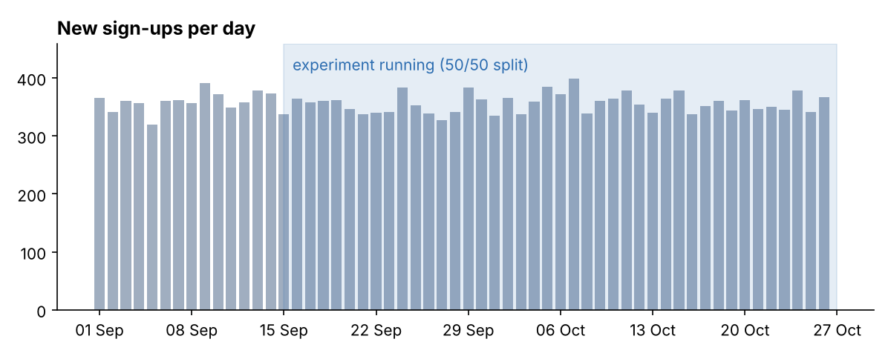
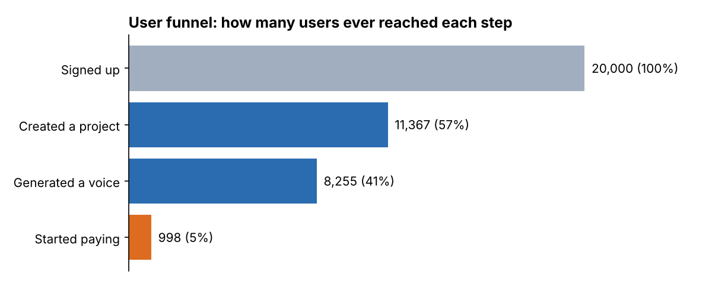

# Onboarding experiment & product analytics

**Did the new guided onboarding increase activation, without hurting paid conversion?**

| | |
|---|---|
| **Product** | Voxly, an AI voice app (fictional, simulated data) |
| **Experiment** | `onboarding_v2`: guided first-voice flow vs. current onboarding |
| **Population** | New sign-ups, 15 Sep – 26 Oct 2026, randomised 50/50 |
| **Status** | Data and design ready · metrics layer in progress |
| **Stack** | Python · SQL · dbt · DuckDB · GitHub Actions |

---

## 1. Business context

Only about 41% of new Voxly users ever generate a voice, the product's core value moment. Users who never reach it almost never return or pay. The product team built a guided onboarding that walks new users to their first generated voice, and ran it as an A/B test before rolling it out.

## 2. Objectives and metrics

Metrics were defined before looking at results.

| Type | Metric | Definition | Decision rule |
|---|---|---|---|
| **Primary** | Activation rate | Share of users with a `voice_generated` event within 7 days of sign-up | Ship if the lift is positive and statistically significant (α = 0.05) |
| Secondary | Usage | Characters generated per user in the first 28 days | Supporting evidence |
| Secondary | Week-4 retention | Share of users active in week 4 after sign-up | Supporting evidence |
| **Guardrail** | Paid conversion | Share of users who start a subscription within 28 days | Must not fall significantly |

## 3. Data

| Table | Grain | Rows |
|---|---|---|
| `users` | one row per user: sign-up time, country, channel, device, pre-sign-up site visits | 20,000 |
| `assignments` | one row per experiment user: variant, assignment time | ~15,000 |
| `events` | one row per product event (`signup`, `session_start`, `project_created`, `voice_generated`, `subscription_started`) | ~306,000 |





**About the data:** the data is simulated ([`data_gen/generate.py`](data_gen/generate.py)), with known effects planted so that each step of the analysis can be validated against the truth:

| Metric | Planted effect |
|---|---|
| Activation | ≈ +4 percentage points |
| Characters generated (active users) | +5% |
| Paid conversion | none |

## 4. Approach

1. **Metrics layer (dbt + DuckDB).** Staging models clean the raw tables. Mart models define activation, feature adoption and weekly retention cohorts once, with tests, so every analysis uses the same definitions.
2. **Product health analysis.** Activation and retention by cohort, channel and device.
3. **Experiment analysis.** Power and minimum detectable effect, sample-ratio mismatch check, difference in proportions with confidence intervals, CUPED variance reduction using pre-sign-up visits, guardrail check, segment breakdown.
4. **Recommendation.** Ship / iterate / stop, with expected impact.
5. **Automation.** GitHub Actions rebuilds the data, runs dbt and its tests on every change.

## 5. Results

To be added as each stage is completed.

## 6. Repository structure

```
data_gen/     data simulation and first exploration
figures/      charts used in this README
```

## 7. Reproduce

```bash
pip install -r requirements.txt
python data_gen/generate.py   # writes data/raw/*.csv
python data_gen/explore.py    # writes charts to figures/
```
